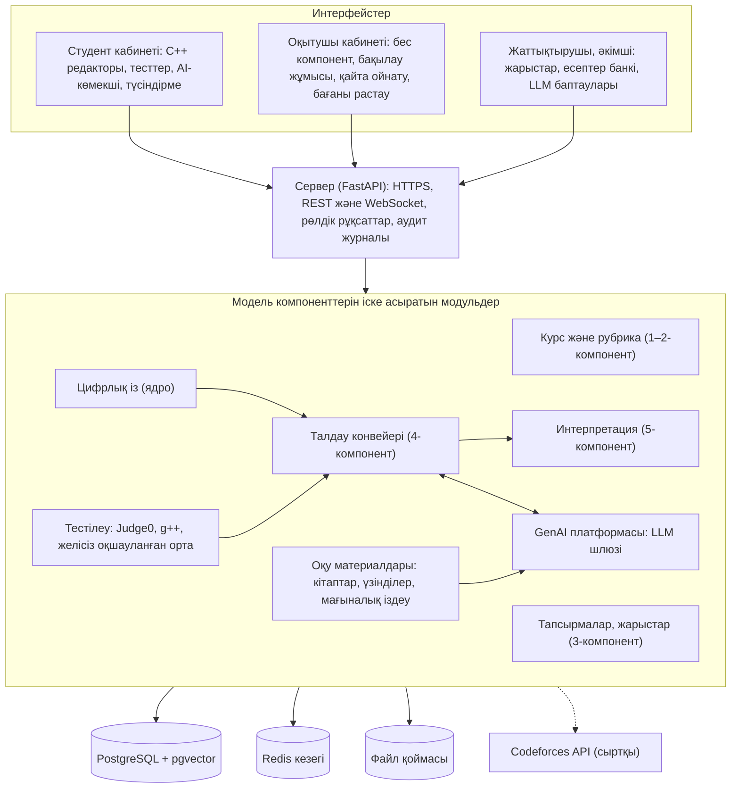

# 11. Архитектура және технологиялар

Студенттің редактордағы әр әрекеті цифрлық ізге жазылады. Тестілеу нәтижесі мен із талдау конвейеріне түседі. Конвейер оқытушы жүктеген кітаптан тиісті үзінділерді алып, LLM шлюзі арқылы рубрика бойынша алдын ала баға жасайды. Интерпретация модулі оқытушы растағаннан кейін студентке кері байланыс береді.

| Қабат | Технология |
| --- | --- |
| Интерфейс | TypeScript, React, Monaco редакторы |
| Сервер | Python, FastAPI, WebSocket |
| Кодты орындау | Judge0, g++ (C++17 және C++20) |
| Статикалық талдау | clang-tidy, cppcheck |
| Дерекқор мен кезек | PostgreSQL, Redis |
| LLM | Groq (Llama), OpenAI, Anthropic, Google API-лері; жергілікті модельдер үшін Ollama |
| Студент моделі | pyBKT, кейін PyTorch (Code-DKT) |
| Мәтін шығару және OCR | PyMuPDF, python-docx, Tesseract (kaz, rus) |
| Мағыналық іздеу | pgvector, көптілді эмбеддинг моделі (мысалы, BGE-M3); қазақ тіліндегі сапасы пилотта тексеріледі |
| Қауіпсіздік | Nginx (HTTPS, сұрау жиілігін шектеу), Argon2id, ClamAV, құпиялар қоймасы (HashiCorp Vault), JPlag |

Жүйенің бүкіл кодын Claude Code жазады (15-бөлім). Judge0 көп тілді қолдайтындықтан, кейін басқа тілдерді қосу оңай.
